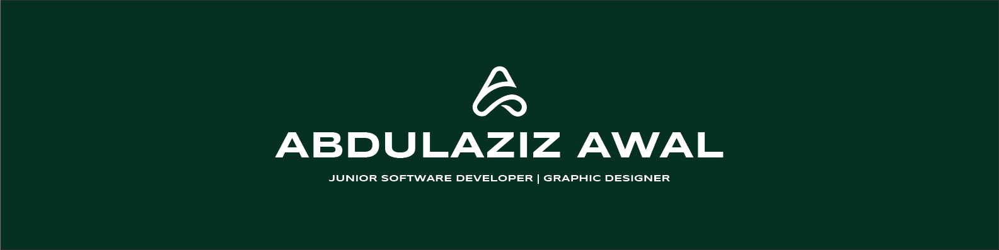

<div align="center">
  
</div>

<br />

<div align="center">

  [](https://aawal-code.github.io)
  [](https://aawal-code.github.io)
  [](https://aawal-code.github.io)

</div>

# aawal-code.github.io

My personal portfolio, and this repository is the website itself, served straight from
GitHub Pages. One page, hand-coded, no frameworks and no build step.

**Live site: [aawal-code.github.io](https://aawal-code.github.io)**

## About me

I'm Abdulaziz Awal, a junior software developer and graphic designer based in Cairo,
Egypt. I work full-stack at [Digi-Sail](https://digi-sail.com), building web
applications (PHP, JavaScript, TypeScript, React.js) and mobile features
(React Native), alongside design work in Photoshop and Illustrator.

## What's inside

| File / folder | Purpose |
| ------------- | ------- |
| `index.html`  | The whole site, one page |
| `css/style.css` | All styling: theme, layout, animations |
| `js/main.js`  | Interactions: typing effect, scroll reveal, cursor, card spotlight |
| `assets/`     | Logo, banner and photo |

## Running it locally

No dependencies, no build. Either open `index.html` directly, or serve the folder:

```bash
# pick one
python3 -m http.server 8000
npx serve .
```

Then visit `http://localhost:8000`.

## Stack

- **Languages:** JavaScript, TypeScript, PHP, HTML, CSS
- **Frameworks:** React.js, React Native
- **Design:** Adobe Photoshop, Adobe Illustrator
- **This site:** semantic HTML, modern CSS (custom properties, grid, keyframe
  animations) and vanilla JavaScript, plus
  [Space Grotesk](https://fonts.google.com/specimen/Space+Grotesk) and
  [JetBrains Mono](https://fonts.google.com/specimen/JetBrains+Mono)

## Contact

- Email: [zizoawal@icloud.com](mailto:zizoawal@icloud.com)
- GitHub: [@aawal-code](https://github.com/aawal-code)
